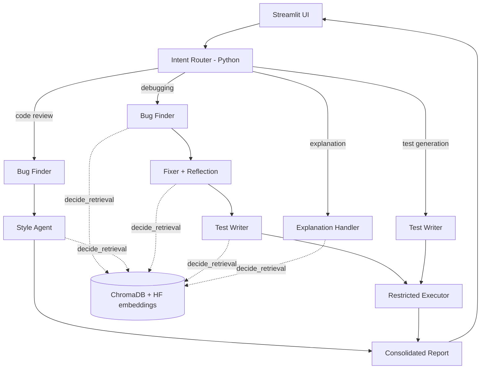

# 🛡️ Code Review & Debug Squad
**Your AI-Powered Code Review Team — four specialized AI agents, one smarter code review.**

## 1. Abstract
A multi-agent AI code assistant that reviews code like a small engineering team. Four specialised agents (Bug Finder, Style & Lint, Fixer, Test Writer) collaborate through an orchestrator. Agentic RAG retrieves programming guidelines from ChromaDB only when useful. The output is a consolidated report with issues, explanations, corrected code, executed tests and recommendations.

## 2. Problem Statement
Students struggle to spot logical errors, runtime issues, edge cases and poor practices. Manual faculty/peer reviews do not scale, and generic chatbots give unstructured feedback. This project separates debugging, quality analysis, correction and testing into explainable, structured steps.

## 3. Objectives
- Build four collaborating agents with distinct prompts and responsibilities.
- Route requests by detected intent (debugging, review, explanation, test generation).
- Ground answers with retrieval from a persistent vector database.
- Verify fixes by executing generated tests in a restricted subprocess.

## 4. Features
Intent detection · 4 agents · reflection-based fixer · agentic RAG with visible sources · Python test execution · dark Streamlit dashboard · downloadable Markdown report · one-click sample · graceful error handling (bad key, rate limit, network, malformed output).

## 5. Technology Stack
Python · Streamlit · LangChain (`langchain-core`, LCEL) · Gemini API (`langchain-google-genai`) · ChromaDB (`langchain-chroma`) · HuggingFace `sentence-transformers/all-MiniLM-L6-v2` · Pydantic.

## 6. Multi-Agent Architecture


## 7. Agent Responsibilities
| Agent | File | Job |
|---|---|---|
| Bug Finder | `agents/bug_finder.py` | Logic/runtime errors, edge cases, infinite loops, severity |
| Style & Lint | `agents/style_agent.py` | Naming, readability, complexity, conventions, score |
| Fixer | `agents/fixer_agent.py` | Corrected code + reflection pass |
| Test Writer | `agents/test_writer.py` | Normal/edge/boundary tests, sandbox execution |

## 8. Agentic RAG Workflow
`rag/retriever.py::decide_retrieval(agent, intent, request)` is a Python policy: debugging → retrieve bug patterns; review → coding standards; test generation → testing guidelines; plain explanation → **no retrieval** (unless the request asks for best practices). If retrieval is chosen, `similarity_search_with_score` runs on ChromaDB (language-filtered), the hits are inserted into the agent prompt as `Retrieved knowledge`, and the **RAG Sources** tab shows every decision, query, document, metadata and similarity score.

## 9. Intent Detection & Routing
`core/intent_router.py`: keyword scoring → Gemini tie-break when ambiguous → default to review. A `WORKFLOWS` table maps intent → agents and `core/orchestrator.py` executes it, passing each agent's output to the next (Bug Finder → Fixer → Test Writer). The sidebar page / "Analysis mode" can also force an intent.

## 10. Prompt Engineering Techniques
All in `core/prompts.py`: **role-based SYSTEM prompts** (one per agent), **USER prompt templates**, **few-shot examples** inside system prompts, **structured output** via Pydantic format instructions, and **reflection prompting** (`FIX_REFLECT_SYSTEM`: the Fixer critiques its own draft). Explanations are requested as concise summaries — no hidden chain-of-thought is claimed.

## 11. LangChain & LCEL
`core/chains.py`: `ChatPromptTemplate` (with `SystemMessage` + human template) `| ChatGoogleGenerativeAI | RunnableLambda(_json_only) | PydanticOutputParser`. Explanation chain uses `StrOutputParser`. Schemas in `core/schemas.py`.

## 12. ChromaDB Implementation
`rag/vector_store.py`: persistent store in `chroma_db/`, cosine space, HuggingFace embeddings, auto-seeded on first use with 15 sample documents (`rag/knowledge_base.py`) plus any `.md/.txt` dropped into `data/coding_guidelines/`. Documents have stable IDs so restarts never create duplicates. **About Project → Inspect vector database** lists everything stored.

## 13. Installation (Windows PowerShell)
```powershell
cd code-review-debug-squad
python -m venv .venv
.venv\Scripts\Activate.ps1
pip install -r requirements.txt
```
If activation is blocked: `Set-ExecutionPolicy -Scope Process -ExecutionPolicy Bypass` then activate again (affects only this window). Or run `.venv\Scripts\python.exe -m streamlit run app.py` without activating.

## 14. Environment Setup
```powershell
copy .env.example .env
notepad .env        # set GOOGLE_API_KEY=... (free key: https://aistudio.google.com/apikey)
```
`GEMINI_MODEL` defaults to `gemini-3.8-flash`; change it in `.env` if your key needs another model. First run downloads the ~90 MB embedding model (needs internet once).

## 15. Running
```powershell
streamlit run app.py
```

## 16. Screenshots
_Add screenshots here:_ `` · `` · `` · ``

## 17. Sample Demonstration
Click **Load sample (find_max)** → **Analyze Code**. Expected: intent *Debugging*; bug "returns 0 for all-negative arrays"; fix initialises with `arr[0]` and returns `None` for empty input; tests for positive, negative, mixed, single-element and empty arrays; the **Original code** column shows the negative-number tests failing while the fixed code passes.

## 18. Acceptance Criteria Mapping
| # | Criterion | Implementation |
|---|---|---|
| 1 | LLM integration | Gemini via `core/llm.py`; key/model from `.env`; handles bad key, rate limit, network errors |
| 2 | Interactive GUI | `app.py`: sidebar, language selector, editor, request box, mode selector, loading status, 7 result tabs, downloads |
| 3 | Prompt engineering | `core/prompts.py`: role prompts, few-shot, structured output, reflection in Fixer |
| 4 | LangChain core | `ChatPromptTemplate`, `SystemMessage`, LCEL pipes, `PydanticOutputParser` in `core/chains.py` |
| 5 | Agentic RAG | `decide_retrieval` + `retrieve`; sources/decisions shown in **RAG Sources** tab |
| 6 | Intent routing | `detect_intent`, `WORKFLOWS`, `run_squad`; intent + workflow shown in UI |
| 7 | Vector database | Persistent ChromaDB + HF embeddings + sample docs + metadata + similarity scores |

## 19. Limitations & Future Work
- Executor is a restricted subprocess, **not** a container sandbox; Windows lacks CPU/memory limits. Only Python is executed; Java/C tests are generated but not run.
- LLM findings can be wrong — treat them as review suggestions.
- Future: Docker sandbox, Java/C execution, file upload, more languages, user-uploaded knowledge, feedback loop (re-fix on failed tests).

## 20. Project Structure
`app.py` · `agents/` · `core/` (llm, prompts, chains, schemas, intent_router, orchestrator) · `rag/` · `tools/` · `data/coding_guidelines/` · `chroma_db/` · `assets/style.css`
